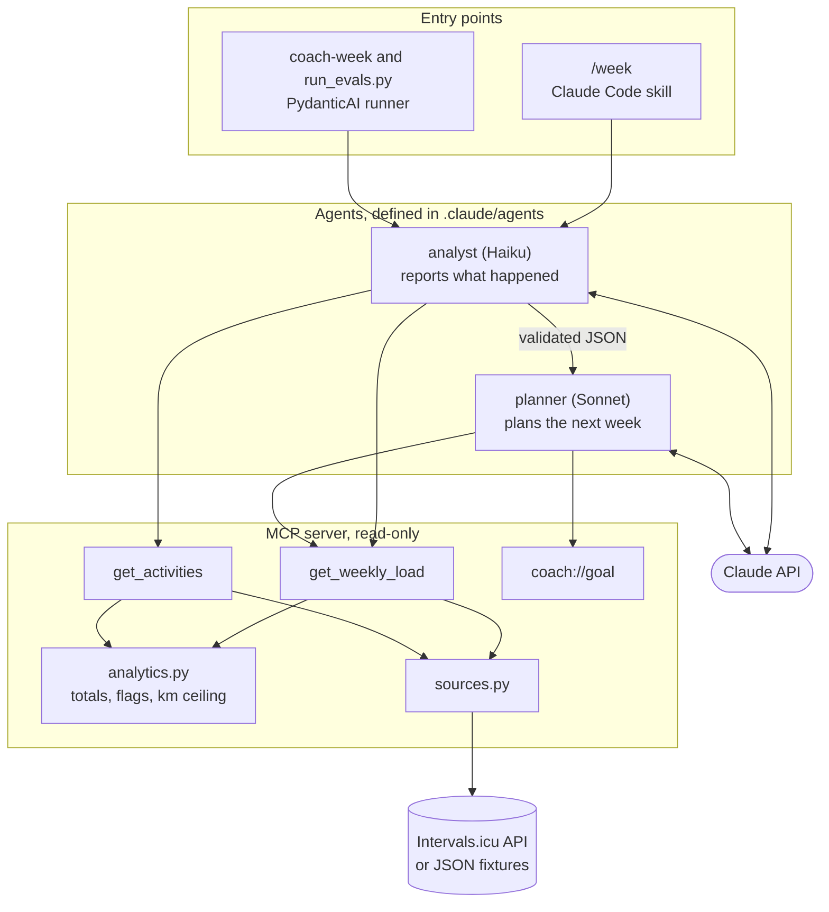

# training-agent-mcp

A read-only MCP server over my running data, with two agents that review a training week and plan the next one.

I set the requirements, made the design calls and ran the evals. Claude Code generated most of the code and wrote the eval cases.

A four-page design overview is in [docs/training-agent-mcp.pdf](docs/training-agent-mcp.pdf).

## Problem

I worked on an enterprise MCP server with over a hundred tools and wanted to try the opposite: a small server with a couple of tools. This one answers two questions from my training data: how was my week, and what should next week look like?

## Architecture



Every number the agents see is computed in `analytics.py`: weekly totals, flags and the ceiling for next week's distance. The models copy those numbers and interpret them. The server only issues GET requests.

## Design decisions

### Two tools

I decided this up front, as a reaction to the large server. `get_weekly_load` answers most questions and `get_activities` inspects specific runs. I did not measure this against a larger tool set, so it is a design choice and not a benchmark result.

### Two agents

Separate agents keep raw tool output out of the planner's context and let cheap extraction run on a cheaper model. In a typical run the analyst costs about $0.001 and the planner about $0.02.

### One definition per agent

The Claude Code command and the Python runner read the same files for prompt, model and tool allowlist. The runner replaces only the planner's output format, because it needs validated fields.

### Stack

Python, Pydantic, the MCP Python SDK, PydanticAI and Logfire are the tools I work with. I left out LangChain because native tool calling and structured output already cover what this project needs.

### Traces carry no content by default

Logfire receives tokens, latency and cost. `COACH_LOG_CONTENT=true` writes prompts and outputs to a local, git-ignored file and sends nothing out.

## Run it

```bash
uv sync
uv run pytest
ANTHROPIC_API_KEY=your-key uv run python evals/run_evals.py
```

The first two commands need no account. The third costs about $0.11 per pass. `uv run python evals/run_evals.py --dry-run` checks the cases against the server without calling a model.

To use your own data, copy `.env.example` to `.env`, add an Intervals.icu API key and copy `data/goal.example.json` to `data/goal.json`. Then run `uv run coach-week 2026-W30`, or `/week 2026-W30` in Claude Code.

## Eval results

Each case runs the real agents on invented data. Checks read fields of the validated output, so wording cannot pass or fail them. An LLM judge scores only what code cannot decide, such as whether a question asks why the runner stopped, and runs only after the code checks pass. Infrastructure failures count as errors and stay out of the pass rate.

| Set | Cases | Attempts | Passed | Cost |
|---|---|---|---|---|
| Synthetic, in this repo | 5 | 15 | 15 | $0.33 |
| My real data, kept out of this repo | 6 | 6 | 6 | $0.15 |

Measured on 2026-11-08. Getting there took fixes, and the earlier runs failed for reasons worth keeping:

- The planner had a rule it could not follow: plan below last week's distance when that distance was 0 km. It invented 9 to 13 km. The server now returns a 10 km safety cap when data is incomplete.
- One judge rubric rejected a field that the output contract requires, although the agent had described the data correctly. The rubric was rewritten after that failure.
- A Haiku judge failed a correct answer in 3 of 10 trials. A Sonnet judge got 10 of 10 on the same answer. Both failed a deliberately bad answer 10 times out of 10. The judge now uses Sonnet.

These results show the system behaves as specified on these cases. They do not show that the plans are good training advice.

## Limitations

- Intervals.icu does not expose Strava-synced activities through its API. All 52 activities on my account since August 2025 come back with a date and no distance, so with live data the system can only report that data is missing. The real eval cases use six runs I transcribed by hand and those unreadable activities.
- The cases are few and share one author. Real cases ran once, and synthetic cases ran three times each.
- The planner tends to fill its limit. There is no taper rule, so the plan for a race 13 days away ranged from 32 to 40 km between runs, and all of those attempts passed.
- The 10 km cap is a cautious project choice, not a validated training rule.
- Cost figures are estimates from token counts and a price table in `config.py`.

Not medical or coaching advice. MIT licensed.
